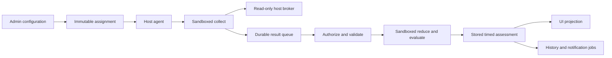

# Platform architecture

TinyWarden separates host observation from interpretation. Skills are data and
bounded Python programs, rather than application plugins with their own pages or
long-running services. The platform owns authorization, scheduling, persistence,
health projection, history, delivery and shared rendering.

## Ownership

| Repository | Owns | Does not require |
| --- | --- | --- |
| [tinywarden](../../README.md) | Web UI, PostgreSQL schema, operator authorization, admission, pure evaluation, projections and background jobs | A source checkout on each monitored host |
| [tinywarden-agent](https://github.com/TinyWarden/tinywarden-agent) | Go host agent, Python SDK/runtime, sandbox, read-only host broker, installer and signed agent releases | App or official-skill source at runtime |
| [tinywarden-skills](https://github.com/TinyWarden/tinywarden-skills) | Official monitoring packages, observation fixtures and repository catalogue | Per-package branches in app or host-agent code |

A compatible skill using existing SDK operations changes only its package. A new
host observation primitive needs a generic SDK/broker contract and capability
review. A new display primitive belongs in the app's shared renderer and Playbook.
Neither extension should require recognizing a particular package ID.

## Observation to screen

Assignments pin package digest, credential generation, settings, approved grants
and policy counters. The host agent checks lease, runtime readiness and package
identity before collection. The app validates the observation, reduces retained
state and evaluates a finite assessment timeline. Pure package work runs outside
SQL locks; committing its result requires another authority/context check.

Reads select stored assessments for the requested time. Opening a page, refreshing
a table or running a history job does not execute package Python. Clock advance can
change a timed assessment or expire evidence without another observation. Contact,
collection freshness and health remain separate dimensions.

Fleet lifecycle and monitoring epochs are platform controls across all skills.
Organization groups do not grant permissions. Maintenance suppresses delivery
while observation continues; pause withdraws collection authority; archive revokes
credentials; permanent deletion fences writes before bounded durable purge.
Retention uses a shared installation policy and irreversible expiration watermark.
The [Fleet reference](fleet-management.md) owns these state, locking and recovery
contracts; skill packages do not implement them independently.

## Trust boundaries

The web app accepts operator cookies and host-agent bearer credentials through
different roots. Operators are authorized again at the transaction boundary;
packages never receive those credentials. Package admission rejects unsupported
schemas, archives, imports and access declarations before execution. Pure methods
have no host broker; collect receives only declared, approved, bounded operations.

The host agent is unprivileged. A supported Linux sandbox and delegated resource
limits are required; failures produce unavailable/unknown evidence rather than an
unsandboxed fallback. Package code cannot restart services, install packages or
open arbitrary network connections. Managed installation/update is a separate
privileged mechanism with signed release verification.

PostgreSQL is owned by one application role. Append-only audit behavior is enforced
by application paths; an owner with database/DDL authority can alter it. This is
not a tamper-proof audit store against the machine or database administrator.
Private configuration, enrollment credentials and package observations must not be
included in public examples or unrestricted logs.

## Current and compatibility paths

New packages use the generic package lane. Compiled disk/baseline collectors and
their v1 transport remain for agents without platform assets. Once a host has
entered the package lane, a runtime failure does not reactivate compiled collectors.
Official aliases preserve established UI/history subjects without running both
implementations. Compatibility code is a retained protocol boundary, not the
extension point for new skills.
See [legacy observation contracts](legacy-observations.md) for the retained lane.

## Find the owning implementation

| Boundary | Source |
| --- | --- |
| HTTP adapters and guards | [server/http](../../server/http) |
| Operator authorization | [server/access](../../server/access) |
| Enrollment, credentials and contact | [server/fleet](../../server/fleet) |
| Admission and contract types | [lib/skills](../../lib/skills) |
| Assignments, settings, results and resources | [server/skills](../../server/skills) |
| Data migrations | [server/db/migrations](../../server/db/migrations) |
| Sampled changes and email | [server/history](../../server/history), [server/notifications](../../server/notifications) |
| Shared UI | [components/playbook](../../components/playbook) |

Continue with [agent protocol](agent-protocol.md), [access control](access-control.md),
[monitoring](monitoring.md), [data lifecycle](data-lifecycle.md) and
[history and notifications](history-and-notifications.md). Exhaustive file ownership
is in the [generated map](../agents/codebase-map.md).
