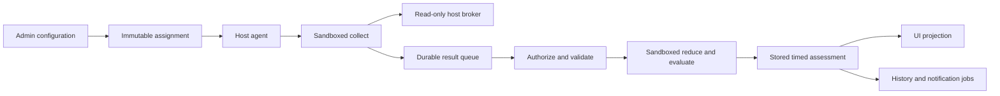

# Platform architecture

TinyWarden separates host observation from interpretation. Skills are data and
bounded Python programs, rather than application plugins with their own pages or
long-running services. The platform owns authorization, scheduling, persistence,
health projection, history, delivery and shared rendering.

## Ownership

| Repository | Owns | Does not require |
| --- | --- | --- |
| [tinywarden](../../README.md) | Web UI, PostgreSQL schema, operator authorization, admission, pure evaluation, projections and background jobs | A source checkout on each monitored host |
| [tinywarden-agent](https://github.com/TinyWarden/tinywarden-agent) | Go host agent, Python SDK/runtime, sandbox, read-only host broker, generic action supervision/recovery, installer and signed agent releases | App or official-skill source at runtime |
| [tinywarden-skills](https://github.com/TinyWarden/tinywarden-skills) | Official monitoring/action packages, native adapters, tests and repository catalogue | Per-package branches in app or host-agent code |

A compatible skill using existing SDK operations changes only its package. A new
host observation primitive needs a generic SDK/broker contract and capability
review. A new display primitive belongs in the app's shared renderer and Playbook.
Neither extension should require recognizing a particular package ID.

Skill actions follow the same boundary: the package owns operations and declares
names, inputs, review and result metadata. The app owns discovery, approved UI
surfaces and shared presentation, including the Fleet Skill actions picker. The
host agent supplies generic delivery, APIs, supervision and recovery. Adding a
compatible action requires only a package release and explicit action permission.
See [action authoring](../build-skills/actions.md#show-actions-on-server-pages-and-in-fleet)
for how a declaration becomes a menu item.

## Observation to screen

Assignments pin package digest, credential generation, settings, approved grants
and policy counters. The host agent checks lease, runtime readiness and package
identity before collection. The app validates the observation, reduces retained
state and evaluates a finite assessment timeline. Pure package work runs outside
SQL locks; committing its result requires another authority/context check.

Reads select stored assessments for the requested time. Opening a page, refreshing
a table or running a history job does not execute package Python. Clock advance can
change a timed assessment or expire evidence without another observation. Contact,
collection freshness and health remain separate dimensions.

Fleet lifecycle and monitoring epochs are platform controls across all skills.
Organization groups do not grant permissions. Maintenance suppresses delivery
while observation continues; pause withdraws collection authority; archive revokes
credentials; permanent deletion fences writes before bounded durable purge.
Retention uses a shared installation policy and irreversible expiration watermark.
The [Fleet reference](fleet-management.md) owns these state, locking and recovery
contracts; skill packages do not implement them independently.

## Trust boundaries

The web app accepts operator cookies and host-agent bearer credentials through
different roots. Operators are authorized again at the transaction boundary;
packages never receive those credentials. Package admission rejects unsupported
schemas, archives, imports and access declarations before execution. Pure methods
have no host broker; collect receives only declared, approved, bounded operations.

The monitoring agent is unprivileged. A supported Linux sandbox and delegated
resource limits are required; failures produce unavailable/unknown evidence rather than an
unsandboxed fallback. Monitoring code cannot restart services, install packages or
open arbitrary network connections. Managed installation/update is a separate
privileged mechanism with signed release verification.

SDK 3 [actions](skills/actions.md) execute separately with exact package/action
authorization and a local publisher/execution-class ceiling. The skill owns the
operation and native adapters; the agent supplies generic delivery, authorization,
supervision and recovery. `host_admin` actions require trust in their root code.
Installing or enabling monitoring never grants that authority.

PostgreSQL is owned by one application role. Append-only audit behavior is enforced
by application paths; an owner with database/DDL authority can alter it. This is
not a tamper-proof audit store against the machine or database administrator.
Private configuration, enrollment credentials and package observations must not be
included in public examples or unrestricted logs.

## Agent and skill ownership

All monitoring runs through independently delivered packages. The agent provides
transport, isolation, resource limits, durable delivery and general host operations.
Skill packages own collectors, interpretation, thresholds, service names, native
action implementations and domain data. The binary carries no built-in monitoring skill and has no compiled observation
fallback. Its filesystem helper returns bounded raw capacity measurements;
interpretation, thresholds and health belong to the requesting package.

A package's subject is its canonical `namespace/slug` manifest ID. There is no
short-name alias list or official-only execution path. Verified publishing origin
still controls the Official badge and reserved namespace; it does not select code.
Runtime-file access follows exact approved file paths and the shared security
policy rather than a list of filenames owned by one skill.

The agent's required architectural check inventories the production dependency graph
for Linux amd64 and arm64, their actual production build inputs, and the complete
bundled SDK. The signed release supports Debian 13 amd64. The check rejects
unreviewed packages/files and known domain identities/recipes; semantic review
is still required for changes inside an accepted file. A source-derived API inventory
and application documentation check keep public calls synchronized. See
[verification](../contributing/verification.md) and the [endpoint index](agent-endpoints.md).

## Find the owning implementation

| Boundary | Source |
| --- | --- |
| HTTP adapters and guards | [server/http](../../server/http) |
| Operator authorization | [server/access](../../server/access) |
| Enrollment, credentials and contact | [server/fleet](../../server/fleet) |
| Admission and contract types | [lib/skills](../../lib/skills) |
| Assignments, settings, results and resources | [server/skills](../../server/skills) |
| Data migrations | [server/db/migrations](../../server/db/migrations) |
| Sampled changes and email | [server/history](../../server/history), [server/notifications](../../server/notifications) |
| Shared UI | [components/playbook](../../components/playbook) |

Continue with [agent protocol](agent-protocol.md), [access control](access-control.md),
[monitoring](monitoring.md), [data lifecycle](data-lifecycle.md) and
[history and notifications](history-and-notifications.md). Exhaustive file ownership
is in the [generated map](../agents/codebase-map.md).

The separate [agent repository](https://github.com/TinyWarden/tinywarden-agent)
owns the host executable and generic Python SDK/runtime. Its Go owners separate
configuration, control-plane transport, durable identity, installation, release
trust, host observation and generic skill supervision. Runtime
Python modules group contracts, host operations, isolation and package admission;
published entry points remain stable. See its
[working guide](https://github.com/TinyWarden/tinywarden-agent/blob/main/docs/agents/README.md).
The [skills repository](https://github.com/TinyWarden/tinywarden-skills) owns
official package sources and independent releases. It consumes an exact SDK pin;
the app consumes a complete verified runtime copy. Neither build requires sibling
source checkouts.

## Independent operation outcomes

The app validates and presents each skill's own operation evidence and separately
aggregates its monitoring health. An unrelated skill's warnings, settings, version
or availability cannot gate action approval or settlement. A completed upgrade
plus a reboot warning stays a completed operation on a warning server. Actions use
local receipts through the generic agent/SDK; the app does not rerun monitoring
checks to certify host maintenance. See [action verification](skills/actions.md#choosing-verification).
